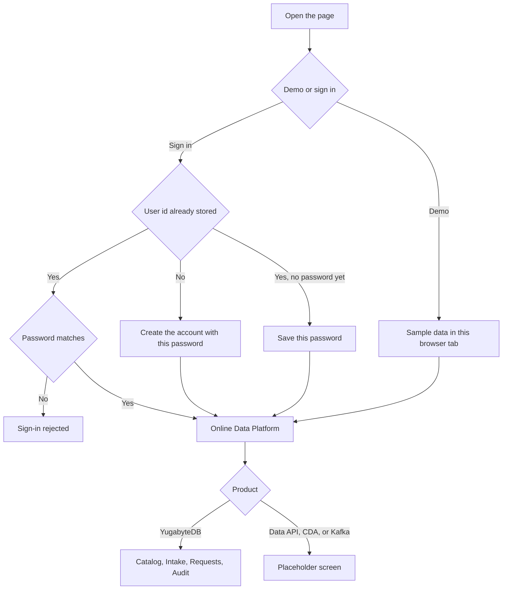
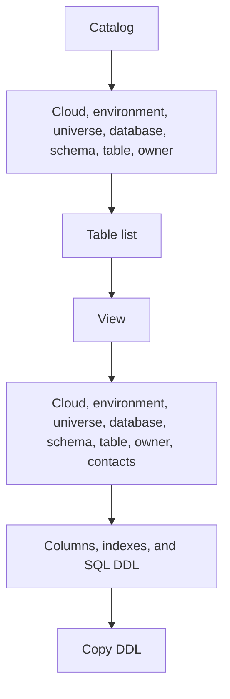
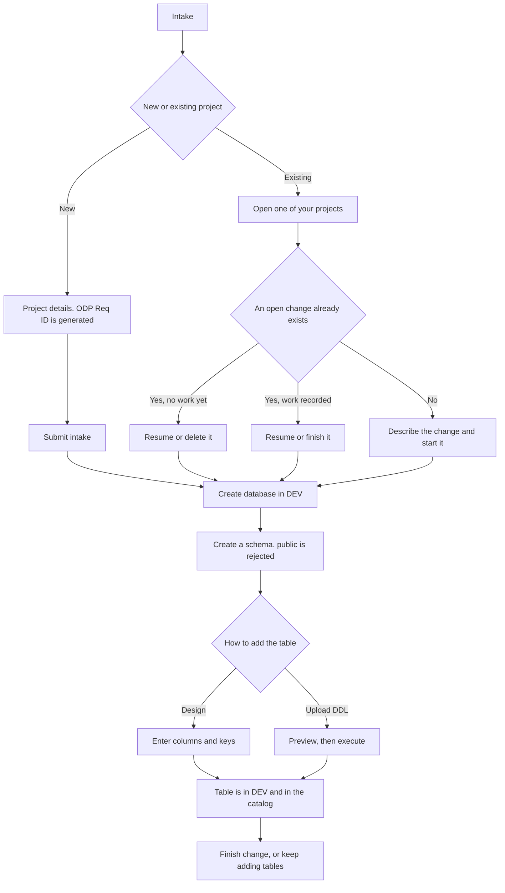
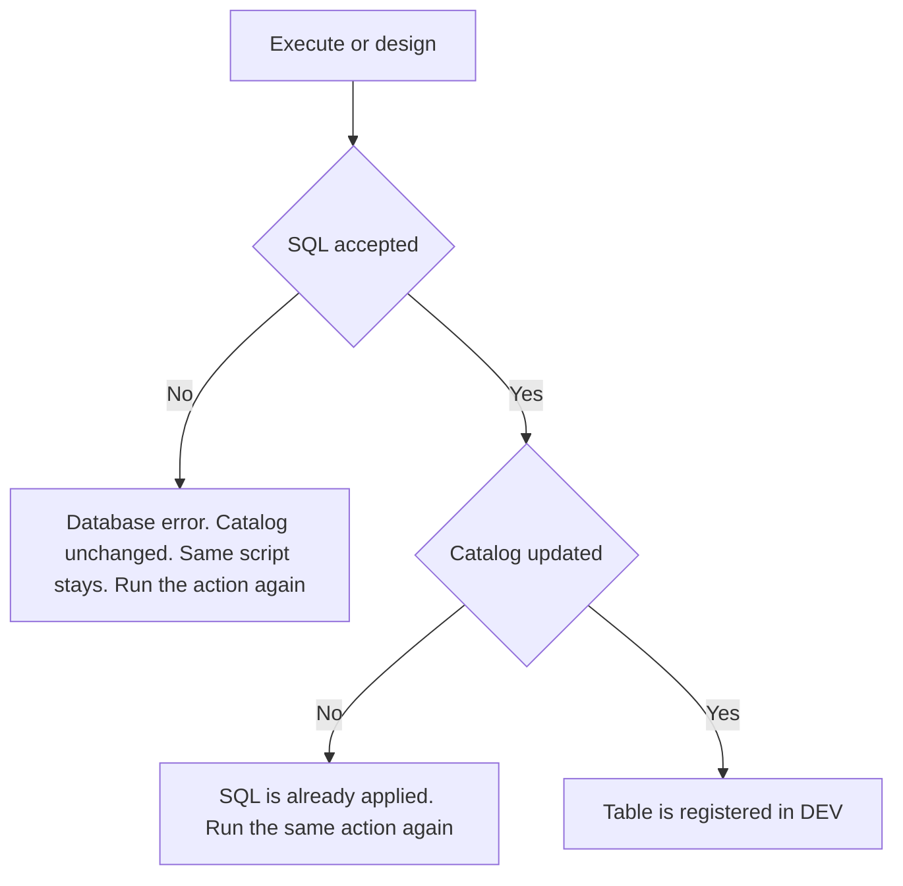
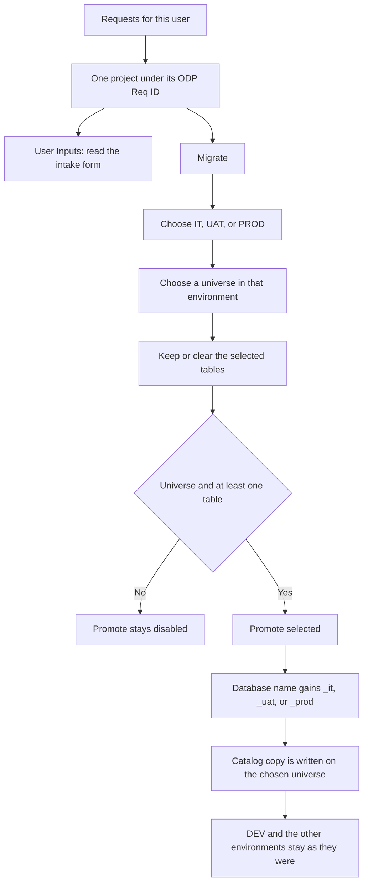

# User flow

A person always starts at the same door. Demo stays in the browser. A real sign-in uses the login API, then the YugabyteDB tabs.

## Catalog

Search is global, or limited to tables owned by the signed-in user.

## Intake

A new project gets an ODP Req ID. An existing project continues under a `REQ-` change. One project can have only one open change.

## When SQL or catalog registration fails

## Requests

Migration starts here, not on Intake. The dialog opens with every table selected.

## Audit

Every sign-in, intake action, and promotion for this user is listed here. A change request groups its database and table work under one `REQ-` id.
